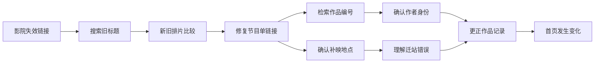

# WIG 网页解谜：重新调研与《昨日首页》玩法方案

版本：方向修订版 v2.0  
调研日期：2026-10-11  
定位：以网页探索、搜索、隐藏页面和信息推理为主体的小体量作品；AI、自动化与少量现实通信用于增强体验。  
文档用途：选题、原型开发、内容制作和发行决策。本文替代上一版偏重 ARG 的方向建议。

> 推荐做一款“通过浏览网站来解谜”的游戏：玩家从旧影院官网出发，沿着关键词、失效链接和历史版本，发现一组相互关联的网站。第一款先验证网页解谜是否成立，再接入可选的现实邮件。首发不以真实短信或真人电话为卖点。

## 1. 先纠正研究对象

### 1.1 本文所说的 WIG

中文创作社区用 WIG（Web Interactive Game）描述一类以网页为主要交互空间的作品，但它不是全球统一、边界固定的行业分类。本文采用一个便于选品和开发的操作定义：**主要线索、操作与结局都位于作者控制的网页环境；玩家通过浏览、检索、访问和解锁网页推进故事。** 社区词条可帮助理解当地用法，不能作为市场规模或术语起源的权威证明。[社区 WIG 词条](https://wiki.mistarg.cn/index.php/WIG)

具体筛选时看“玩家必须做什么”，而不是只看作者或平台贴了什么标签。

| 判定维度 | 本次核心方向 | 不作为本次主体 |
|---|---|---|
| 主要场景 | 模拟企业官网、论坛、博客、档案站、旧互联网 | 真实城市、社交账号网络、线下活动 |
| 主要操作 | 找词、搜索、访问、比对、解锁、修复链接 | 联系真人、持续追踪现实账号、组织线下行动 |
| 推进条件 | 作者预先设计的网页与规则 | 主持人实时响应、社群集体协作或现实事件 |
| 时间结构 | 单人随时开始、暂停、完成 | 必须在某个现实时间等待或参与 |
| 现实通信 | 可选的回声、奖励、叙事延续 | 唯一线索来源或通关硬门槛 |
| 工程重点 | 内容结构、搜索规则、页面表达、存档 | 多渠道通信编排、实时角色运营 |

网页解谜也不等于“把密室题目放在网页上”。网页的栏目、日期、用户名、链接、搜索结果和失效状态，应该直接构成谜题。若换成十张图片仍能原样玩，网页媒介的作用就太弱。

### 1.2 上一版需要改变的地方

- 把主循环从“接收跨媒介消息—整理证据—提交判断”改为“发现网页异常—提出检索假设—找到新页面—重新理解旧页面”。
- 把“现实消息很多”改为“网页世界足够可信，一两次现实回应就能产生余味”。
- 把复杂通信后台改为可独立运行的网页内容包，服务端只承担必要的增值功能。
- 把“多渠道互动”从产品类型降为可选功能，防止再次做成 ARG。

## 2. 样本与证据：哪些值得研究，哪些需要剔除

### 2.1 调研方法与限制

本次结合作者页面、作品入口、网页内容、平台规则和技术文档。证据分三档：

- **直接观察**：实际读取到的页面结构，或在浏览器中执行过的操作。
- **作者／平台说明**：公开自述，可以确认其声明，不能替代完整实测。
- **设计推论**：从已知交互提炼的制作方法，不宣称是原作的内部实现。

没有完成所有作品全流程通关，也没有获取其后台、源码或经营数据。不能由 `.html` 后缀推断“完全没有后端”，不能把平台点击数当作独立玩家数，更不能由“标记通关人数÷启动次数”计算可靠完成率。

### 2.2 核心和邻近样本

| 作品 | 本次定位 | 核查到的内容 | 可借鉴之处／证据边界 |
|---|---|---|---|
| 《大学生登山失踪事件》 | 中文 WIG 核心样本 | 作者入口、引导说明、餐馆首页、搜索提交 | 从普通商业网页进入隐藏信息网络；搜索出现特殊反馈及未定位的显示问题，未完成通关 |
| 《かがみの特殊少年更生施設》 | 网页搜索结构样本 | 官网、栏目、院生作品目录、页面编号 | 日常栏目构成内容容器；仅研究网页部分，不把整个跨媒介 IP 归为纯 WIG |
| 《寻找陈雨彤》 | 中文题材与入口样本 | 收录页介绍、作者、免费与设备标签、原入口 | 可用于观察中文作品包装；原入口访问受限，不推断具体解法 |
| 《沂河往事》 | 中文地方记忆题材样本 | 收录页、作者与作品标签 | 支持地方往事题材的选题参考；没有足够实测支持机制拆解 |
| 《山茶》 | 旧档案／终端邻近样本 | 收录页介绍、作品原入口 | 观察复古信息界面的题材表达；本次原站未成功访问 |
| Type Help | 浏览器文字调查邻近样本 | 作者介绍、HTML5 平台标签、商业重制入口 | 低视听成本的信息探索可以成为完整作品；不把它直接等同于仿网站 WIG |
| 《我的秘密花园》 | 边界对照，排除出核心样本 | 作者说明要求去现实社交媒体找部分内容 | 不能因它也有网页，就当成本次要模仿的主体 |

中文补充样本来源：[寻找陈雨彤](https://miyeji.cn/games/xun-zhao-chen-yu-tong)、[沂河往事](https://miyeji.cn/games/yi-he-wang-shi)、[山茶](https://miyeji.cn/games/shan-cha)。这些是目录证据，不是完整玩法验证。

### 2.3 《大学生登山失踪事件》：入口为什么有效

作者作品页提供了当前入口。引导说明介绍以关键词找到隐藏网页的推进方式，强调可见信息即可游玩，不要求编程或查看源码；浏览器中的餐馆首页则提供菜单、公告等日常信息。其页面编号给探索提供边界感。[作者作品页](https://ginga-light.top/works)、[作品引导入口](https://missing.minis.yoroll.ai/?config=missing&lang=zh)

本次实际操作到“阅读引导—进入餐馆首页—提交搜索”；搜索结果出现“此文件已被禁止访问／undefined”。后续阅读公开代码后确认，“禁止访问”标题本身可以是作者主动设计的剧情反馈；`undefined` 的具体来源仍未定位。因此不能把整个页面判为网络故障，也不能声称已经验证后续谜题。[搜索页源码](https://raw.githubusercontent.com/Shiroki-Y/College-Student-Missing/main/search-results.html)

由此提炼的设计方法是：

1. **让普通网页先成立。** 餐馆网站天然有菜单、招聘、公告、地址，足以承载很多不同类型的信息。
2. **把下一步写在信息里。** 玩家自己发现一个值得搜索的词，比系统弹出任务更有参与感。
3. **输入获得新页面，就是奖励。** 不一定需要积分、装备或华丽动画。
4. **搜索入口必须可靠。** 搜索故障和“搜错了”长得太像，异常状态必须与无结果状态区分。

以上是对外部体验的设计分析，不是对原作代码架构的逆向结论。

### 2.4 Kagami：普通栏目如何变成叙事空间

作品网页以机构官网呈现，含理念、介绍、院生作品等入口；作品目录继续分为绘画、海报、照片、漫画和作文，首页及子页可见编号。它还明确标注内容虚构。[官网](https://kagamino-jrep.net/)、[院生作品目录](https://kagamino-jrep.net/student-works/)

这里值得借鉴的是**信息的社会身份**：同一件事写在公告、学生作文或宣传材料里，读者会自然赋予不同的可信度。谜题可以来自这些表述之间的矛盾，而不是到处插入密码锁。

设计上应让表层栏目能够正常阅读，深层线索才有藏身之处。编号可以暗示作品还有深处，但首作不必追求原作规模；页面多不等于推理多。其主页显示的总编号也不等于本次已经验证的可玩页面数量。

### 2.5 Type Help：借鉴信息组织，不照搬界面

作者将它描述为调查旧电脑文件的谜题悬疑游戏，页面标为 HTML5，并链接到商业重制版《The Incident at Galley House》。这提供了“网页作品验证创意，进一步开发商业版本”的实际路径案例，但没有公开数据足以推导收入或转化率。[作者作品页](https://william-rous.itch.io/type-help)

本项目借鉴的是：少量可重复的交互动作，可以承载大量信息变化。是否好玩取决于新材料能不能改变理解，而不是交互种类越多越好。

### 2.6 为什么剔除《我的秘密花园》

作者明确说明部分内容需要到真实社交媒体寻找。因此它可作为跨边界体验的对照，却不适合作为本次“封闭网页主线、现实元素辅助”的核心范本。调研中最初将它列为候选，核查作者说明后调整分类。[作者游玩说明](https://anninganya-glitch.github.io/My-Secret-Garden/)

## 3. 底层玩法逻辑：真正的资源是玩家的理解

### 3.1 两张图同时运行

**页面图**决定玩家能够去哪；**认知图**决定玩家为什么想到去那里。

页面图的边可以是普通链接、搜索词、密码、日期、文件名。认知图的边则是“这个昵称是不是同一个人”“新版删掉的那行有什么意义”。如果只有页面图，游戏容易变成点链接；如果只有认知图而缺少明确操作，玩家会不知道怎样表达推断。

一个有效谜题需要三件事同时成立：

> 资料给出可观察差异 → 差异支持一个合理假设 → 页面提供能验证假设的操作。

例如：旧相册与新相册有一张照片署名不同；两处都保留同一作品编号；玩家用编号搜索，找到改名说明。这比“猜作者生日当密码”更公平，也更贴合网页媒介。

### 3.2 六种适合低工程成本的谜题

| 类型 | 玩家动作 | 乐趣来自哪里 | 主要制作成本 |
|---|---|---|---|
| 关键词发现 | 从公告提取词语并站内搜索 | 找到了别人没注意到的入口 | 搜索别名和结果映射 |
| 页面版本差异 | 切换同页的新旧版本 | 被删除的信息获得意义 | 两份内容与差异设计 |
| 断链修复 | 根据规则修正旧链接 | 理解了旧网站如何组织内容 | 少量确定性解析规则 |
| 跨站身份关联 | 比对用户编号、签名、作品 | 同一人以不同身份留下痕迹 | 人物资料一致性 |
| 文件／权限谜题 | 用已知信息打开特定资料 | 理解资料属于谁、为何被隐藏 | 输入容错与反馈 |
| 叙述矛盾 | 对照公告、帖子、图片说明 | 从“看见信息”到“推翻解释” | 剧本与公平线索 |

首作优先选择前三种，加一种身份关联。不要为了“玩法丰富”同时加入音频倒放、复杂密码学、二维码拼接、现实地图和源码搜索。

### 3.3 控制难度的核心变量

- **候选范围**：玩家在两个人名中选择，比从整页三十个名词中猜一个更容易。
- **证据距离**：两条线索隔一页，还是隔三个网站，难度不同。
- **操作明确度**：知道去搜索框试，比不知道该搜索、拨号还是改网址更容易。
- **重解释次数**：发现新信息后需要推翻几次旧理解，决定推理深度。

难度应主要来自后两条信息之间的关系，而不是故意挑剔输入格式。全半角、首尾空格、日期分隔符和明确的同义表达应当容错。

### 3.4 公平性与节奏

每个关键谜题至少记录：线索来源、预期推断、接受输入、错误反馈、下一页、三级提示。卡关时先提示“去哪里看”，再提示“看什么关系”，最后才给具体操作。

每次正确操作至少带来一种变化：新地点、新人物关系、旧解释被推翻，或新的操作规则。只开出另一张写着密码的纸，连续两次就会疲劳。

前五分钟必须形成一次完整循环；中段容许两条分支并行；结尾收束为对人物行为的理解。玩家可以提前猜到正确入口，不必强迫他先读完系统指定的所有页面。

## 4. 产品构想：《昨日首页》

### 4.1 一句话介绍

**一家旧影院重新开业，官网却保留着一条通往十七年前的失效链接。你沿着它修复一场被误记的放映，也找回一个被网页删去的名字。**

类型：单人 WIG 网页解谜。  
体验：日常、怀旧、轻悬疑，有情感反转；无需恐怖惊吓。  
规模目标：完整篇 75—120 分钟、约 28 个内容页面、8—10 个主要解谜节点。时长是设计目标，必须通过盲测确认。  
平台：电脑浏览器优先，同时保证手机可完成主线。  
现实层：可选的结局邮件；虚拟电话完全在网页内；真实短信作为后续独立可行性验证。

### 4.2 三个鲜明特征

**同一页有两个年代。** 玩家发现旧快照后，可以回到同一内容位置比较。当年不起眼的名字、如今修改的措辞，成为主要线索。历史版本由作者编写，不依赖真实互联网档案服务。

**修复链接就是推进故事。** “404”背后不是随意猜字符，而是已被页面解释过的迁移规则。玩家逐渐从读网页变成理解这座小城的网站是怎样连接起来的。

**最终要修复的是一条记载。** 真相不靠最后一段旁白突然公布。玩家已经从不同网页读出了事情经过，结局只要求把人物、事件和作品编号对应回正确位置。

这些是本项目的组合设计，不声称某一种机制从未被其他作品使用。

### 4.3 世界与真相：作者视角

虚构小城“松岚”的旧影院准备重新营业。新版官网称，2009 年最后一场学生短片展因设备故障取消，片单只保留三名创作者。

实际发生过一场改到摄影社小厅的补映，放映的是林遥拍摄的《归灯》。她因家庭搬迁退出社团，曾请管理员停止展示个人资料。迁站时，网站把“移除个人介绍”错误处理为“移除关联作品”，之后的编辑又只依据缺损片单编写了停业回顾。

当年的放映员周启一直保留节目表和录音，却没有公开替林遥做决定。玩家要厘清：放映是否举行、作品属于谁、哪个名字应当恢复，以及哪些私人资料仍不应公开。

这里的悬念是“互联网如何把一件发生过的事写成没有发生”，而不必依赖谋杀、失踪或庞大阴谋。

### 4.4 四组网页，实际一个工程

| 网页外观 | 表层用途 | 承担的玩法 | 内容页面预算 |
|---|---|---|---:|
| 松岚影院官网 | 重开公告、排片、历史介绍 | 新旧版本、第一次搜索 | 7 |
| 松岚旧论坛 | 社团讨论、二手器材、活动帖 | 昵称与身份、引用关系 | 8 |
| 光隙摄影社 | 作品册、场地介绍、展映日历 | 作品编号、日期和图片说明 | 7 |
| 旧站存档工具 | 快照列表、迁移说明、链接修复 | 跨站检索、404 修复、最终更正 | 6 |
| 合计 | 不含帮助、设置、商店等系统页 | 约 16 页直接参与主线，其余用于背景和旁支 | 28 |

“四个网站”通过版式、字体、栏目和语言风格区分，不需要购买四个域名。默认呈现当前网站，仅在发现存档服务后出现简洁的历史版本入口。避免开场先给玩家一整套仿操作系统或案件管理台。

### 4.5 前十分钟的实际体验

1. 玩家打开影院重开公告，注意到“最后一场放映”的文字链接打不开。
2. 失效页保留旧链接标题“第七排”，并说明旧文章可按标题在存档里检索。
3. 搜索“第七排”，得到 2009 年的观影留言。有人写：“影院没亮灯，不等于那晚没放映。”
4. 留言链接到旧排片页。玩家切换到新版，发现旧版多出一场“光隙特别场”，新版只写“取消”。
5. 点击旧版中的摄影社署名，进入第二种风格的网站；那里有一张并非在影院拍摄的散场合照。

玩家已经完成“观察—搜索—对照—访问新站”。此时仍不要求登录，不索取手机号，也不出现 AI 聊天窗口。

### 4.6 可直接用于原型的主线节点

以下为原创设计稿，包含剧透；编号是制作标识，实际界面不显示关卡列表。

| 节点 | 已有线索 | 玩家操作与接受输入 | 获得的信息／下一步 |
|---|---|---|---|
| N01 失效链接 | 影院公告上的“最后一场放映” | 点击链接 | 404 保留标题“第七排”和存档搜索入口 |
| N02 找回留言 | 404 明示可按旧标题检索 | 搜索“第七排”，兼容“第7排” | 留言否认“没有放映”，链接旧排片页 |
| N03 同页异文 | 旧排片有“光隙特别场”，新版无此项 | 切换 2009／2026 版本，点击摄影社署名 | 摄影社场地页证实当年有小厅 |
| N04 修复节目单 | 场地页的旧链接为 `show_091017.htm`；迁移说明示范“show_年月日 → screenings/年月日，年份补全” | 在站内修复框输入 `screenings/20091017`；亦接受带前导斜杠 | 得到 2009-10-17 节目单，第四项被标为“作者资料已移除”，作品号 GX-041 |
| N05 追作品号 | 节目单留下 GX-041 | 摄影社搜索“GX-041”，兼容去掉连字符 | 打开《归灯》作品页，缓存署名“木木”，关联论坛用户 u17 |
| N06 找同一个人 | 作品页链接 u17；论坛提供公开旧昵称记录 | 查看 u17 的资料历史 | “木木”旧昵称为“林间遥灯”；公开社团名册将 u17 对应到林遥 |
| N07 验证放映 | 节目单日期、摄影社合照说明互相支持 | 在活动日历选择 2009-10-17 | 展映日志说明活动改到小厅，确认《归灯》放映；同时链接管理员迁站记录 |
| N08 理解删除 | 迁站记录含作者主动公开的撤下个人简介申请及字段迁移说明 | 对照 `profile_removed` 与新版错误联动的作品缺失 | 明白“删个人资料”被误处理为“删作品”，更正应恢复作品署名而非私人资料 |
| N09 提交更正 | 名册、作品页、展映日志三个事实一致 | 更正表填写作品号 GX-041、作者林遥、场地光隙小厅 | 规则逐项校验；错项只提示回看对应资料类型，不清空其他答案 |
| N10 新首页 | 正确更正被收录 | 回到影院官网 | 同一首页出现修订说明和补全片单；可查看后记、选择现实邮件纪念页 |

N06 与 N07 可以并行。N04 的迁移规则只要求模式识别，不需要程序知识。N08 展示的是作者在故事中主动公开的申请节选，不让玩家“攻破私人邮箱”才能理解真相。

内部校验用规范形式；显示给玩家的输入可以容错，例如“光隙摄影社小厅”“光隙小厅”指向同一答案。作品编号、日期、身份、场地都要在至少一处明确出现，不靠猜作者脑中的措辞。



### 4.7 旁支与结局控制

第一版只有一个完整主结局，外加两段可选后记。选择影响语气与纪念页内容，不把主线拆成大量分支。

旁支一：从器材交易帖得到旧影院分机号，在网页内拨打，听到周启的二十秒录音，补充那晚气氛。旁支二：在摄影社补全三张照片的说明，得到林遥成年后的一段公开留言。

所谓“网页发生变化”只修改当前玩家本地的结局状态，不真的让所有玩家共同改写公开网站。这样有明确反馈，也不引入多人状态冲突。

## 5. AI、自动化与现实元素：各自承担什么

### 5.1 AI 首先参与制作，其次参与游玩

| 使用位置 | 具体任务 | 是否影响真相 | 首发决策 |
|---|---|---|---|
| 制作阶段 | 生成页面骨架、整理日期表、检查人物称谓和链接 | 人工审核后才进入内容包 | 使用，投入产出最高 |
| 搜索容错 | 汇总盲测中真实出现的合理搜索表达 | 作者批准后加入固定别名表 | 使用离线辅助，运行时不用模型 |
| 游戏内“旧站助手” | 用通俗语言解释玩家已打开页面中的旧术语 | 只能解释当前已见资料 | 可选，小流量试验 |
| 自由 AI 角色 | 任意聊天、动态编造往事、即时生成谜题 | 容易改变事实和泄露答案 | 首发不做 |

旧站助手的设定是“存档阅读辅助”，不是知道所有答案的侦探。玩家问“这页的迁移是什么意思”，可以得到简短说明；问“林遥最后怎样了”，如果当前材料没有答案，应提示现有资料不足。

服务端只提供被允许解释的段落和预写提示等级，不把整份剧本传给模型。回复包含引用的页码；无法给出引用时回到固定说明。模型不写入通关状态，不决定密码，不生成关键证据。设调用上限与超时降级，停用模型后整个游戏仍可完成。

### 5.2 自动化优先解决作者的重复劳动

优先自动化四件事：检查断链和线索依赖、生成不同站点的统一构建包、对搜索别名做回归验证、为已确认的邮件请求去重发送。

主线不需要定时任务：所谓“旧邮件抵达”“页面更新”可由玩家本地事件直接触发。没有理由为了制造悬念，把一个本来能即时完成的动作变成现实等待两小时。

### 5.3 现实邮箱：首个适合落地的外部通道

设计为结局时的可选动作：“把修复后的片单寄给未来的自己”。玩家也可以在网页立即保存同一内容。

流程：主动选择 → 验证收件地址 → 展示将发送的内容 → 确认寄送 → 收到带有所选影院纪念语的邮件。地址验证用于防止冒用他人邮箱，不强迫普通玩家注册。邮件标题可以保留故事气氛，发件身份和页脚应清楚标注作品。

首发使用预写模板，仅替换昵称、所选纪念语和不含关键权限的回访标识。一次请求只产生一封结局邮件；发送失败不改变通关结果，用户可主动重试。不要向邮箱发送登录口令或明文存档秘密。

进阶版本才允许玩家回信选择一段额外后记。收信技术可使用支持入站 webhook 的邮件服务；例如 Resend 官方文档提供自有验证域名或托管子域的收件机制。实际可用性、域名验证和目标邮箱送达仍需测试。[Resend 收件文档](https://resend.com/docs/dashboard/receiving/introduction)

### 5.4 虚拟电话：在网页里完成，而不是接入真实电话网

玩家获得分机号后，在影院网页的旧电话界面输入。程序查表播放预录音频，同时显示字幕。可包含拨号声、等待一秒、留言结束的机械提示，但不要求麦克风、通讯录或手机号。

这项功能只需要音频文件、一个输入框和几种状态。它是网页内的演出，不需要语音识别、实时语音模型或电话供应商。若以后使用合成语音，优先在制作阶段生成并审核固定音频，首发运行时不生成。

### 5.5 真实短信：保留构想，不承诺上线能力

可设想的用途是用户主动预约后收到一条“片单已修复”的提醒，内容在网页同样可见，不把短信当成唯一密钥。

但中国内地通道有实际限制：本次核查的阿里云通知短信规范明确写到游戏相关业务仅支持验证码短信。因此，不能把任意剧情短信包装成验证码来发送，也不能将接通 API 等同于业务获准。[阿里云通知短信规范](https://help.aliyun.com/zh/sms/user-guide/notification-template-specifications)

如果未来做海外实验，应针对具体国家、发送主体、模板和供应商逐项验证；本次没有得到一个能承诺覆盖所有目标地区的方案。首发物料不写“会收到真实神秘短信”，避免把未验证的通信能力变成售卖承诺。

## 6. 开发架构：先让核心作品成为一个静态包

### 6.1 推荐技术形态

首作使用 HTML、CSS、TypeScript 和轻量构建工具即可；熟悉 React 或 Vue 的团队可沿用，但不需要为了这款游戏先搭通用引擎。核心能力是路由、内容模板、搜索映射和本地存档。

```text
作者编写内容与谜题规则
        │
        ├── 页面数据：正文、版本、站点皮肤、图片、音频
        ├── 规则数据：搜索别名、链接迁移、答案、提示
        └── 构建前校验：失效引用、关键页可达、事实一致
                         │
                  静态网页内容包
                         │
              浏览器：探索、判定、本地存档
                         │
              可选的少量服务端接口
                 ├── AI 解释代理
                 └── 验证邮箱与发送模板邮件
```

免费原型不需要账号、数据库、支付或实时服务。付费浏览版再增加购买权益校验；如果只是免费试玩加付费下载完整包，则可进一步减少自建交易工程。

### 6.2 单域名、多网站外观

站内路由表示虚构站点和内容，例如 `#/cinema/history?year=2009`。hash 路由便于静态托管和嵌入式平台导出；网页中的旧链接修复框只处理游戏定义的路径，不接受任意外网地址。

玩家能复制链接、返回上一页、刷新恢复位置。手机上用“当前／历史”切换代替必须左右并排对比；所有线索避免只存在于鼠标悬停或右键菜单中。

素材使用相对路径并随内容包交付，核心字体、图片和音频不依赖外部网站临时加载。首次资源预算可暂定压缩后 5 MB 内，其余按需加载；这是本项目性能目标，需实测。

### 6.3 内容数据与状态分离

建议目录：

```text
content/
  pages/             四组网站页面及历史版本
  people.json        人物、用户编号、昵称历史
  timeline.json      故事的真实时间线
  search.json        关键词与结果映射
  puzzles.json       判定、错误反馈和三级提示
assets/              图片、音频、字体
src/
  router/            页面地址、历史记录
  renderers/         公告、论坛、相册、存档四类模板
  rules/             输入规范化、搜索、判定
  save/              本地存档、导入导出、版本迁移
optional-service/    AI 代理、邮箱验证、模板发送
```

最小存档只保存内容版本、已访问页面、已解谜题、收藏与结局选项。不要把手机号、邮箱或付费权益混进用户可编辑的普通存档。

本地存档有清理浏览器数据后丢失的风险，因此提供一键导出和导入；在外部嵌入平台测试时，另测存储隔离和隐私模式。导入文件做字段与大小校验，不执行其中的任何内容。

### 6.4 搜索应是可控的游戏规则

搜索顺序：规范化输入 → 精确匹配 → 人工审核的别名匹配 → 预写无结果反馈。一个输入可以返回两三条结果，给玩家判断空间；不要默认为每个关键词都直接跳唯一正确页。

不要实时用大模型搜索整份剧本。否则玩家输入“直接告诉我结局”可能越过谜题，而且不同玩家得到的信息边界不一致。

区分三种状态：词语不匹配、页面在故事中确实缺失、系统请求失败。第三种必须明确允许重试，不能伪装成谜题。

### 6.5 静态内容与付费内容的边界

免费游戏允许愿意查看源码的人自行剧透，不必投入昂贵的防作弊系统。隐藏页面的作用是构造探索，而不是承担真实安全隔离。

但付费完整版不能先下载到所有人浏览器，再只靠按钮或本地变量锁住。浏览器付费版需要服务端验权后提供内容；离线付费包则接受购买后可被复制的现实，不承诺无法破解。具体选择取决于后续商业验证，而不是首个原型先全做。

API 密钥只在服务端保存；邮件接口限制频率并验证地址，避免成为任意发信代理。AI 响应作为文本渲染，不能直接当作 HTML 或代码执行。

### 6.6 托管选择

静态原型可采用满足项目条件的静态托管。Cloudflare Pages 的静态资源和 Functions 有不同计费规则，增加 API 后需要单独核算动态请求；不能因为网页能免费托管，就认为邮件、模型和后台永远免费。[Cloudflare Pages Functions 定价说明](https://developers.cloudflare.com/pages/functions/pricing/)

GitHub Pages 可作为符合条款的非商业原型托管候选；其官方限制明确排除把它当成以经营在线业务、交易或商业 SaaS 为主的免费托管。付费业务不要直接沿用“免费个人网页”的假设。[GitHub Pages 使用限制](https://docs.github.com/en/pages/getting-started-with-github-pages/github-pages-limits)

面向中国内地的最终部署、收费主体和发行形式应单独核验适用要求。技术上可打开网站，不等于完成商业发行条件。当前文档不把任何托管商列为当然具备国内游戏发行资格的平台。

## 7. 内容生产：省工程，不省谜题编排

### 7.1 推荐制作顺序

先写真实时间线和人物关系，再写“谁在什么页面留下了什么痕迹”，最后才把这些页面排成玩家可发现的路径。

每个页面使用一张制作卡：表层用途、正文事实、可疑细节、输入／输出线索、关联页面、需要核查的时间与称谓。如果某页面只有“给下一关密码”这一种用途，优先重写成可信的公告、帖子或说明。

使用 AI 写不同网站语气之前，先锁定事实表；生成后逐页核对日期、人物称谓、作品号。AI 可以帮忙换文风，但“同一事件在不同人口中怎么说”应由作者决定。

### 7.2 页面预算比代码预算更重要

28 个页面不是写 28 篇长文章。建议正文多数控制在一屏到两屏：有的页面只需一张节目单，有的需要一段争论，有的承担关键事实。低信息密度的正常内容用于建立可信度，不能无限灌水。

首作准备四套可复用模板、少量历史版式差异、约十张关键图像和一至两段短音频即可。不要每个页面都做独立复杂视觉效果；也不要让四种网站看起来像同一个组件库换色。

### 7.3 必须验证的项目

- 关键谜题存在合理路径，没有只存在于作者脑中的前提。
- 前五分钟能够发现第一条有效搜索线索。
- 输入容错覆盖盲测中合理但原本未预料的表达。
- 跨站返回、刷新、存档导入后，页面和版本位置一致。
- 手机可读全部关键线索，静音可完成全部主线。
- 邮件、AI 服务关闭后仍可通关。
- 付费版本若采用浏览器验权，未购买用户拿不到完整受限内容。

这些检查直接保护谜题和付费边界，不需要为每段文案写形式化测试。

## 8. 上架平台与获取玩家：三件事分开决策

### 8.1 收录、托管、收费不是同一项服务

| 入口／平台 | 本次核实的能力 | 适合本项目的用途 | 不能直接假定的能力 |
|---|---|---|---|
| 谜页集 | 作品发现、作者展示、原始入口、评价与攻略；明确不托管、不参与收费发行代理 | 争取中文垂直玩家曝光，提交正式作品入口 | 平台替你运行游戏、收款或办理发行 |
| Wao | 页面宣称免费游玩、创作套餐、免费发布托管与作品发现 | 非技术作者试做和小样展示的候选 | 当前方案天然支持作者向玩家售票，或能导出全部源码接任意 API |
| itch.io | 托管 HTML5 网页游戏；官方文档列明浏览器作品捐赠与下载售卖的区别 | 海外／双语免费试玩、玩家反馈、付费下载版 | 默认提供原生的 HTML5 浏览器付费墙 |
| 自有网站 | 页面和服务可自行控制 | 中文品牌入口，后续可控的浏览器完整版 | 自带自然流量、交易资质或发行资格 |
| Steam 等下载商店 | 本次 Type Help 样本有商业重制路径 | 成熟作品的包装版或重制版 | 给原网页套壳就会获得销量 |

谜页集官方明确区分收录与交易，提交入口需要登录。本次仅查阅，没有提交作品。[平台说明](https://miyeji.cn/about)

Wao 当前定价页写明玩家游玩免费，向创作者销售制作套餐；Free 列有免费发布托管，Plus 标示 ¥29／一个月期限。这是**创作工具的收费**，不能当作 WIG 玩家付费意愿的证据。源码导出、自定义域名、外部接口与收费权限，本次未验证，应在采用前确认。[Wao 定价页](https://waoowaoo.com/pricing)

itch.io 支持包含 `index.html` 的 HTML5 内容包，其官方说明目前 HTML5 游戏主要接受捐赠；售卖可采用 Downloadable 类型。这意味着“免费浏览器试玩＋付费下载完整版”比假定存在原生网页付费墙更直接。海外收款和目标用户访问情况也需实际验证。[itch.io HTML5 文档](https://itch.io/docs/creators/html5)

### 8.2 第一款的发布路径

1. 自有稳定入口发布 15—25 分钟免费序章，片段具有完整小结局。
2. 提交垂直收录平台；用作者渠道发布一段不剧透的真实操作演示。
3. 收集玩家在搜索和版本比对处的卡点，修复后再扩完整篇。
4. 有足够完成率和兴趣反馈后，选择付费下载完整包，或另行建设浏览器付费版。
5. 系列跑通后再考虑大型商店包装、多语言和线下衍生。

序章不能刚输入正确关键词就弹付款框；它至少完整回答一个问题，同时让人意识到更大的问题尚未解决。

### 8.3 传播素材应该展示什么

展示一段“普通网页突然变得可疑”的十秒操作：同一页切换年代，少了一个名字；顺着失效链接修复地址，出现旧节目单。吸引玩家的是自己也想试试，而非宣传 AI 能聊多少句。

提供不剧透封面、短描述、预计时长、设备要求、音频是否必需、保存方式和分级提示。完整攻略与普通评论分开，减少无意剧透。

## 9. 变现逻辑：卖完整作品，不卖被卡住的解法

### 9.1 当前证据能支持什么

调研样本中能见到免费网页作品、创作者工具收费和网页作品商业重制。它们证明路径存在，不能证明独立中文 WIG 的平均售价、付费转化率或收入规模。本次没有获得可审计的市场规模与销售数据，不据此制作“市场很大”的结论。

### 9.2 推荐顺序

| 方式 | 适用阶段 | 判断 |
|---|---|---|
| 免费序章＋完整篇买断 | 主线验证后 | 首选候选；价格和销售形态仍需验证 |
| 自愿支持／数字设定册 | 第一款免费作品 | 低开发门槛，但收入不可预期 |
| 独立后续篇章 | 模板和作者受众形成后 | 复用工程，仍需投入新的剧本和谜题 |
| 品牌定制网页解谜 | 已有可展示成品 | 潜在项目制收入，需求与服务成本另算 |
| IP 实物、活动或商业重制 | 作品已有明确影响力 | 作为后续选择，不纳入首作回本假设 |
| 广告、付费提示、短信按条收费 | 不推荐首发 | 容易打断注意力，并把挫败感变成收费点 |

第一轮可以测试完整篇 ¥19 与 ¥29 两种价格表达，但它们是本项目的实验价格，不是本次调查得出的行业均价。不要为了支撑订阅制而承诺周更长篇谜题。

### 9.3 一个透明的回本算例

设付费完整篇价格为 ¥29；交易、退款、税费等合计暂按售价的 15% 做测算预留；单份可变服务成本按 ¥0.80 预算；首作固定投入按 ¥20,000 估算。

```text
单份贡献 = 29 × (1 − 15%) − 0.80 = 23.85 元
回本销量 = 向上取整(20,000 ÷ 23.85) = 839 份
```

这些都是建模假设，不是平台报价或税务结论。固定投入应把自己的工时、外包与美术计入；可变成本必须把免费用户的 AI 调用和失败请求按实际使用量分摊进去，不能只看付费玩家单次成本。

如果售价 ¥19、其余假设相同，则单份贡献为 ¥15.35，约需 1,303 份回本。这个敏感性说明：**低价并不会自动降低商业难度。** 控制内容制作成本和提供清晰试玩价值，比先做大量现实消息更重要。

## 10. 开发里程碑与是否继续投入的判断

以下排期是假设一名具备基本前端能力的制作者、复用模板、每日有效投入，并有少量外部盲测者。不会把“AI 能写代码”当作压缩全部创作时间的保证。

| 阶段 | 范围 | 预计投入 | 通过条件 |
|---|---|---|---|
| 纸面验证 | 时间线、主线节点、关键页文案 | 2—3 天 | 别人只看材料也能说出推理关系 |
| 可玩小样 | 8—12 页、搜索、新旧版本、一次断链修复 | 4—7 天 | 15—25 分钟循环完整，有小结局 |
| 首轮盲测 | 5—8 人，无作者现场指导 | 2—3 天 | 找出主要卡点，区分谜题难与界面不懂 |
| 完整篇 | 约 28 页、主结局、存档与移动端 | 2—3 周 | 全流程可独立完成，关键事实一致 |
| 可选增强与发布 | 虚拟电话、结局邮件、发布材料 | 3—5 天 | 通信关闭不阻碍游戏，版本可回滚 |

总计约 4—6 周是排期假设；剧情反复、素材重做或支付集成会延长工期。真实短信和实际电话网接入不在此估算中。

### 10.1 第一轮只判断四件事

- 至少大多数测试者能在五分钟内找到第一条有效线索。
- 卡关时能说出自己的假设，而非“我不知道这个页面能干什么”。
- 完成者能用自己的话解释两处版本差异的意义。
- 有人愿意继续探索完整篇；进一步用真实购买实验验证，不能把口头好评当转化率。

可以把“8 名测试者中至少 6 名无口头帮助完成序章”作为内部迭代门槛，但样本太小，不应用来推断总体市场完成率。

### 10.2 最小埋点

只记录必要事件：开始、首次有效搜索、第一次版本比对、修复成功、提示级别、序章结束、完整篇购买成功。分别计算访客、开始者、完成者，不混用平台启动数。

搜索失败统计优先归类为“未匹配”“错别字”“规则不明”，不默认长期存储用户自由输入原文。对搜索日志做抽样与脱敏，避免玩家误输个人信息造成额外负担。

## 11. 最终决策清单

| 问题 | 本版决策 |
|---|---|
| 做什么类型？ | 网页本身就是场景和谜题的 WIG |
| 哪种乐趣最重要？ | 玩家自己发现下一页，以及旧页面被新线索重新解释 |
| 先验证什么？ | 搜索、新旧版本、断链修复能否形成完整小样 |
| 核心差异是什么？ | 通过修复旧链接和页面记载，还原一场被误记的放映 |
| AI 放在哪里？ | 制作辅助优先；受约束的已见资料解释作为可选项 |
| 现实互动先做什么？ | 用户主动选择的结局邮件；网页内预录电话 |
| 真实短信怎么办？ | 独立核实业务通道后再决定，不进入首发承诺 |
| 工程如何控制？ | 单域名、四种页面皮肤、静态内容与确定性规则 |
| 如何获取玩家？ | 可玩序章、垂直收录、真实操作演示 |
| 如何收费？ | 优先验证完整作品买断；不把提示和通信次数作为主要商品 |
| 何时停止加功能？ | 当新增功能不再改善“发现下一页”的体验时 |

建议下一步制作《昨日首页》的 8—12 页序章，先让一位没有参与创作的人，在没有作者讲解、没有 AI 帮忙、没有收到任何现实消息的情况下，顺利体验一次完整的网页解谜。这个结果成立，融合能力才有值得增强的主体。

## 附录：主要来源与用途

以下链接均为本次调研所用公开页面；动态页面、价格和服务规则以实际使用前再次核查为准。作品入口无法访问时，已在样本表标注，没有以搜索摘要替代完整实玩。

1. [WIG 社区词条](https://wiki.mistarg.cn/index.php/WIG)：中文社区用法，非行业标准。
2. [银河电灯作品页](https://ginga-light.top/works)：核对作者与当前游戏入口。
3. [大学生登山失踪事件入口](https://missing.minis.yoroll.ai/?config=missing&lang=zh)：引导规则与浏览器访问，访问状态存在波动。
4. [Kagami 官网](https://kagamino-jrep.net/)：模拟官网表层结构。
5. [Kagami 院生作品](https://kagamino-jrep.net/student-works/)：内容栏目组织。
6. [寻找陈雨彤目录页](https://miyeji.cn/games/xun-zhao-chen-yu-tong)：中文样本信息。
7. [沂河往事目录页](https://miyeji.cn/games/yi-he-wang-shi)：中文样本信息。
8. [山茶目录页](https://miyeji.cn/games/shan-cha)：中文样本信息。
9. [我的秘密花园作者说明](https://anninganya-glitch.github.io/My-Secret-Garden/)：跨现实社交平台的边界对照。
10. [Type Help 作者页](https://william-rous.itch.io/type-help)：HTML5 作品及商业重制路径。
11. [谜页集平台说明](https://miyeji.cn/about)：发现、托管、收费职责边界。
12. [Wao 定价](https://waoowaoo.com/pricing)：创作工具收费模式与公开功能。
13. [itch.io HTML5 文档](https://itch.io/docs/creators/html5)：打包、托管与付费方式限制。
14. [GitHub Pages 限制](https://docs.github.com/en/pages/getting-started-with-github-pages/github-pages-limits)：托管用途边界。
15. [Cloudflare Pages Functions 计费](https://developers.cloudflare.com/pages/functions/pricing/)：动态服务与静态托管分开核算。
16. [Resend 收件文档](https://resend.com/docs/dashboard/receiving/introduction)：邮件入站与 webhook 能力。
17. [阿里云通知短信规范](https://help.aliyun.com/zh/sms/user-guide/notification-template-specifications)：剧情短信的实际业务限制。
