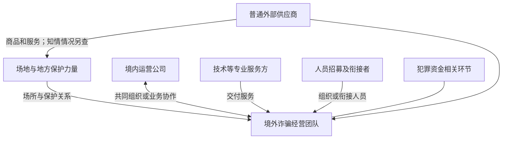

# 电诈相关“公司”如何运作：真实案例与澄川定位修正

研究日期：2026-10-18  
目的：确认游戏中公司的业务、组织和境外关系。先修正世界设定，不继续扩写人物、不改代码。  
方法：以法院典型案例、检察机关材料、公安通报为主，结合跨国犯罪研究。案件发生时间与报道发布时间分别说明。本文分类是研究归纳，不是法律分类，也不是行业占比统计。

## 一、先纠正此前最关键的误解

**一家公司看上去正常，不意味着它必须有一套合法主营业务；它也可能一直在以公司的形式经营犯罪业务。**

真实的办公室、招聘、工资、主管、考勤和报销，只能说明它在组织人员工作，不能证明这些工作的目的合法。相反，一项犯罪可以需要持续生产、交付、管理和结算，因而呈现出公司化组织。

此前的澄川设定将“普通资料服务公司—新合作项目—员工转岗—境外受控”串起来，主要靠人员去向连接两端。它没有首先回答：澄川的业务产出，对诈骗活动有什么直接价值？

更有依据、也更简单的修正是：**澄川本身就是跨境诈骗业务的境内运营节点。主角以为自己在做互联网营销与客户运营，逐渐发现这些工作正在服务于欺诈。**

这是一项基于案件的创作建议，不表示所有互联网营销公司都有这种问题。真实业务与违法业务混合也可能存在，但不必为了让办公室可信，先给澄川安排三个合法客户，再额外接入一条输送人员的故事。

## 二、新闻里的“公司”，至少有四种不同含义

| 用语 | 应如何理解 | 对游戏设定的影响 |
|---|---|---|
| 公司化诈骗团伙 | 以公司称谓、层级和管理方式运作的犯罪组织；报道中的名称不自动证明它是合法登记的法人 | 可以有完整日常办公，诈骗本身就是业务 |
| 具有实体经营的涉案公司 | 有员工、办公室和实际交付，但交付内容或服务对象涉及犯罪 | 最适合承载长期办公和业务推理 |
| 空壳公司 | 本报告指缺乏相应实质经营、主要被利用其登记身份或账户的主体；不能把一切涉案公司都叫空壳 | 不适合同时描写几十名员工每天完成丰富业务，却完全不解释业务是什么 |
| 被利用或与犯罪发生接触的正常企业 | 某些人员、服务或供应关系被犯罪利用，是否知情、是否参与要分别判断 | 不能仅凭一个涉案客户，就认定整个企业属于诈骗集团 |

例如，最高检公布的南明区案例涉及注册公司后转卖营业执照和对公账户，账户随后被用于接收涉诈资金。这说明“壳”可能主要服务于身份和资金环节，并不意味着其内部存在一个完善的客服部门。[最高检，2023-11-30，案例十一](https://www.spp.gov.cn/spp/xwfbh/wsfbt/202311/t20231130_635188.shtml)

GI-TOC 的 2026 年供应链研究介绍则区分了不知情的外部企业与主动参与者：园区需要外部商品和服务，但供应关系本身不能证明共同控制或同等责任。[GI-TOC，2026-01-13](https://globalinitiative.net/analysis/minimizing-risks-of-criminal-exposure-to-scam-compounds-in-corporate-supply-chains/)

## 三、真实案件提供了哪些清楚的公司模型

### 1. 境内引流公司，与境外团伙共同组织业务

最高法、最高检 2024 年公布的王某等人案件中，组织者在国内共谋，境外设立诈骗窝点，另有人在国内成立引流公司，双方分工实施虚假投资诈骗。相关行为发生于 2019 年，境外地点为缅甸勐拉。[最高法，2024-07-26，案例六](https://www.court.gov.cn/zixun/xiangqing/439351.html)

**能得出的结论：**境内办公室可以是同一犯罪业务的组成部分，并非只负责把员工送出去。这里的“引流”指向潜在被骗者的接触与转交，必须与招募工作人员区分。

**不能得出的结论：**案件没有为我们提供具体 OA 界面、全员知情比例，也不能证明每个此类公司都替园区招人。

### 2. 国内技术公司，向境内外诈骗团伙交付软件

黄石警方在 2022 年公布的一起案件中，四川某公司位于高新区写字楼，挂着云计算科技招牌。负责人对接境内外诈骗组织的需求和报价，其他相关人员承担涉诈软件、网站开发。通报当时处于侦办阶段，不能写成已经生效的判决。[黄石市公安局，2022-08-26](https://gaj.huangshi.gov.cn/fwms/jfts/202208/t20220826_934053.html)

**能得出的结论：**公司的交付可以真实存在，问题在交付的功能、目的及明知程度。技术供应商也可能服务多个团伙，不一定属于某个园区的子公司。

**设计意义：**需求、交付、客户反馈本身就可能与犯罪相关，不需要另外制造“电脑里偶然遗留一份人口买卖名单”的入口。

### 3. 境外诈骗组织，按企业层级持续管理

“远峰集团”案显示，境外团伙设有老板、主管、组长等层级，并进行培训、工具配备与奖惩管理。同批公布的罗欢等人案还显示业务、技术、后勤和后台服务的分工。[最高法，2022-09-06，案例一、二](https://www.court.gov.cn/zixun/xiangqing/371131.html)

**能得出的结论：**组织架构、业务分工和重复的日常工作并不与犯罪性质矛盾。所谓“业务员”“客服”“技术”，可能就是犯罪活动内部的岗位名称。

**不能得出的结论：**所有团伙都具有相同部门，或都使用某种商业办公系统。分工不是统一模板。

### 4. 园区运营者与入驻诈骗团队，可能是不同层次

明家案一审公开材料记载，相关家族势力设立多个园区，吸引不同“金主”入驻并提供武装庇护。这里只用其查明的组织关系，不将一审报道当成该案此后全部程序的最新状态。[最高法，2025-09-29](https://www.court.gov.cn/fabu/xiangqing/477701.html)

**能得出的结论：**园区不是必然只有一个老板、一家公司。控制场地与提供保护的人，和经营具体诈骗业务的人，可以各有利益和管理范围。

**不能得出的结论：**某个境内办公室一定直接接受园区势力指挥。它可能只与园区里的某一个诈骗团队有关系。

### 5. 场地经营与诈骗经营，也可能由同一人兼做

2024 年典型案例中的李某某，既组织诈骗，也将部分场地提供给其他诈骗团伙，并提供相关保障。梁某案同样涉及场地管理和服务收费。[最高法，2024-07-26，案例一、三](https://www.court.gov.cn/zixun/xiangqing/439351.html)

**能得出的结论：**“场地方—经营方”的区分是分析工具，现实角色可能重叠，不能机械画成永远互不相关的独立公司。

### 6. 先在国内工作，再被招募到境外，有明确案例；但不能随意补成被贩运

人民法院报刊载的案例报道中，一名毕业生先在西安一家被称为证券公司的单位工作，三个月后，负责人以更高待遇招募他去境外工作；后续审理涉及境外诈骗。该篇还报道了广州公司招用毕业生参与涉诈工作并发放工资的案件。[最高法转载人民法院报，2023-07-25](https://www.court.gov.cn/zixun/xiangqing/406902.html)

**能得出的结论：**国内入职、领取工资和后来赴境外，可以属于同一犯罪背景下的人员流动。

**不能得出的结论：**报道没有据此证明那些国内业务原本合法，也不能把判决中的人员自动改写成完全不知情、后来被强迫贩运的受害者。岗位名称也不代表具备相应行业资质。

### 7. 招募和控制人员是独立的问题，不能与公司经营模式混为一谈

最高法 2024 年另一批案例分别涉及组织人员出境、提供犯罪帮助以及人员遭限制自由等情形。它们说明人员进入方式、参与程度和后来的处境需要逐人核对，不能用“去过境外公司”代替事实调查。[最高法，2024-02-07](https://www.court.gov.cn/zixun/xiangqing/425102.html)

**设计意义：**公司为什么让某人赴境外，与这个人抵达后是否能够自由退出，是两个需要分别建立因果的问题。不能把“公司涉诈”自动接成“它对所有员工的目标都是卖人”。

## 四、这些公司实际靠什么运转

以下是结合上述案例进行的功能归纳，描述的是角色与利益，不是任何单一集团的完整运作手册。

### 1. 首先要分清谁在付钱、买什么

| 经营位置 | 实际提供的东西 | 收益关系的基本性质 | 是否必须直接接触被骗者 |
|---|---|---|---|
| 诈骗业务经营者 | 组织和执行欺诈活动 | 收益最终来自被骗取的财产 | 团队中的部分岗位会接触 |
| 境内引流或运营节点 | 为涉诈业务提供接触对象、运营协作等 | 可属于集团内部投入，也可构成付费协作；具体案件分别确认 | 部分岗位会接触，辅助岗位未必 |
| 技术服务方 | 涉诈系统的开发与服务 | 按双方约定取得报酬；不能预设都按赃款分成 | 可以不接触 |
| 场地与保障经营者 | 办公住宿、场地控制及相关保障 | 场地、服务费用或利益分配，具体取决于案件 | 不一定接触 |
| 招募与人员衔接者 | 为团伙组织人员 | 与人员供给有关的收益；不应把所有招聘都等同于人口贩运 | 接触的是求职者或被招募者 |
| 非法资金服务或账户环节 | 为犯罪资金提供相应条件 | 从相关服务或交易中获利 | 不一定接触 |

因此，澄川如果是技术供应商，它的“客户”可能是诈骗经营者；如果是引流团队，员工口中的“客户”又可能指将被转交的人。写故事时必须把两个含义分开，否则玩家连公司卖什么都无法理解。

也不要把“客户付费”自动写成合法交易。确实付费购买技术或推广服务的客户，本身可能在经营犯罪。

### 2. 公司化管理解决的是持续组织问题

案例已经证明培训、层级、工作分配和保障等组织活动存在。由此可以合理理解其管理需求：人员需要分工，任务需要交接，设备需要维护，负责人需要了解工作完成情况。具体采用邮件、聊天、表格还是专门系统，应按所选虚构公司设定，不能声称公开案件已经证明其使用我们设计的 OA。

对游戏而言，日常工作完全可以真实、重复，甚至很枯燥。秘密在于这些工作的用途，以及管理者隐瞒了哪些事实。办公室不需要每天上演威胁和密谈，才具有犯罪性质。

### 3. 钱从何而来，决定“高薪公司”为何存在

旧设定为了解释正常发薪，增加了大量独立的合法项目。这并非唯一可能的解释。

如果境内公司本来就提供诈骗链条需要的服务，它的人员成本就是该业务的投入。支付工资可以是为了完成持续业务，而不是为了将来贩运员工先支付的“养人费用”。这里不需要假设犯罪利润无限，也没有依据预设统一利润率或统一人头价格。

反过来，如果坚持把公司写成主要靠贩运员工获利，就必须解释为何需要那么多业务部门、为何长期维持办公室、为何把员工安排在与招募无关的岗位。没有具体案例支撑时，不应用复杂背景掩盖这些问题。

### 4. 员工的知情程度不能由职位名称决定

可用于人物设计的区别包括：

- 明确策划、出资或管理犯罪的人。
- 知道关键业务有问题，仍继续提供有实质作用的协作的人。
- 起初受工作包装影响、后续逐步接触异常的人。
- 与涉案业务缺乏实际联系的普通服务人员。
- 受到人身控制、被胁迫参与的人。

这是叙事上需要核对的事实，不是本报告对罪名或责任作分类结论。一个人物也可能在不同阶段处于不同处境。

对主角的约束尤其重要：如果他长期直接接触完整欺骗材料，故事却一直宣称他完全不知情，会失去可信度。应写清他之前实际接触的工作范围，以及哪一次发现改变了他的认识，而不是让“试用期员工”成为万能免责设定。

## 五、境内公司与境外“产业”是什么关系

**有直接关系，也有间接关系；不能把合作、控制和登记关系混成一件事。**

### 1. 共同组织、直接协同

境内与境外环节由同一批组织者安排，分别承担不同工作。前述王某案是这种关系的明确参考。工商上是不是母子公司，不是识别实际协同的唯一问题。

用于虚构时，只需让澄川负责人知道服务于什么业务，并与境外具体经营团队存在稳定联系。没有必要再安排一个“中间朋友”逐层引入犯罪。

### 2. 外包或买卖服务

技术、运营或其他支持由外部人员或公司提供。它们可能面对多个客户，直接对接诈骗经营者，也可能隔着项目联系人。关系是否成立、是否明知、实际提供什么，都要有具体事实。

“接到了境外订单”不足以证明涉诈；“自己只提供一段服务”也不足以证明与犯罪无关。四川技术公司的案件说明，真实交付与涉案性质可以同时存在。

### 3. 场地、保护与经营的关系

在部分园区型案例里，场地和保护层为多个经营团队提供条件。经营团队再与各自的境内外协作方联系。这里是利益网络，不必是一棵只有上下级关系的组织树。

GI-TOC 对东南亚园区的研究介绍强调，相关运作与地方权力、商业和犯罪交织。不同地点、时期的条件不同，不能把一个家族或武装的情况套用于整个缅甸或东南亚。[GI-TOC，2025-05-29，报告介绍](https://globalinitiative.net/analysis/compound-crime-cyber-scam-operations-in-southeast-asia/)

### 4. 普通供应关系或不知情接触

电力、物流、餐饮、建筑和通信等服务都可能与园区发生联系。前述 GI-TOC 供应链研究关注的正是参与程度的差异，而不是宣布所有供应商都是犯罪成员。

对游戏而言，某公司向涉案地点供货可以构成调查入口，不能直接作为有罪结论。

### 关系示意

下图只解释可能存在的关系，不代表所有案件都有这些层次；部分角色可能由同一主体承担。

还需要区分：公司登记地、实际办公地、人员所在地点、服务器位置和受害者所在地点。这些可以不同，某个域名或登录位置不能单独证明“总部在缅北”。

## 六、两条容易被混淆的现实材料

### 有依据：国内工作后被招募赴境外

前述西安案例支持这类事件存在。它对我们保留“入职一两个月后收到新的岗位安排”有参考价值，但不能替代对具体虚构事件的说明。

### 被辟谣的具体传言：重庆公司正常上班数月后借团建送缅北

2023 年，中国互联网联合辟谣平台刊载重庆市互联网举报中心信息，否认了当时“江北嘴某公司让员工正常上班数月后，借出国团建送往缅北，警方已立案”的具体传言。[原文，2023-08-16](https://www.piyao.org.cn/20230816/0b7ee6ce22c44d0ca1219d60099956d1/c.html)

**这不等于所有利用工作或旅行诱骗的事件都不存在。** 它的意义是：不能把这则传播很广的具体传言，当作我们公司设定已经有现实依据的证据。

同样，直接从境内岗位调往境外、被虚假职位诱骗出境、已经知情仍参与后又遭到控制，是不同事件类型。故事应选择明确的一种人物经历，不能只用“被骗去缅北”把此前所有行为省略。

## 七、澄川应如何重新定位

以下是创作建议，和前文的案件事实分开。

### 推荐定位：境外诈骗团队的境内营销运营中心

一句话定义：

> 澄川对外经营财经资讯与投资教育产品的用户运营，实际是一个境外虚假投资诈骗团队的境内运营公司。

这里的“中心”是功能描述，不预设它在工商登记上一定是某境外公司的分支机构。

这一业务外观和公司名称属于虚构选择，不是说财经资讯或投资教育本身涉嫌犯罪。定位之所以收窄，是为了让公司的产出、付费方与境外接收方能用一条清楚的业务关系说明，避免继续用“综合资料服务”容纳任何剧情。

| 问题 | 建议固定的答案 |
|---|---|
| 公司平时做什么？ | 活动资料、客户运营协作、项目报表与人员管理；具体岗位只接触其中一部分 |
| 谁付钱？ | 对应业务的经营者或共同组织者，不能用不相干的合法客户解释全部收入 |
| 公司主要服务谁？ | 境外具体经营团队，不是抽象的“整个缅北产业” |
| 老板知不知道？ | 核心经营者知道业务性质；不再把老板写成偶然接错订单的普通创业者 |
| 为什么有办公室和正常工资？ | 工作本来就在持续产生业务价值，员工需要被组织、管理和支付报酬 |
| 为什么新人暂时未看清？ | 他接触的岗位范围有限，对服务对象和业务解释存在误解；这一理由必须经具体材料检验 |
| 为什么可能出现境外岗位安排？ | 是同一业务内部进一步参与或人员配置的安排，不是临时冒出的无关人贩子剧情 |
| 是否就是空壳公司？ | 若存在这些实体业务，不宜把澄川本身叫纯空壳；业务是犯罪性的，不是不存在 |

林见可以是运营支持专员，平时整理项目资料、反馈和月报。是否能合理保持有限认识，需要根据他实际接触的材料决定；不能让他一边直接执行明显欺骗，一边仍被作者称为完全不知情。这比另设一套无关的合法客户故事更需要认真写，但业务关系更清楚。

这会使主线直接得多：

**我在替什么平台做运营 → 所谓客户和业务成果究竟是什么 → 国内工作怎样与境外团队相连 → 我的下一项安排意味着什么。**

它也会改变个人危机的来源：主角不仅担心未来是否被骗出去，还要理解自己眼前的工作究竟参与了什么。该问题比“人事是否擅自替我确认”更接近公司定位本身。

这里不需要把员工写成全员同谋，也不需要为了维持主角无辜，把所有业务都写成合法。人物应按所见、所知和实际行动分别建立。

### 一个可行备选：涉诈平台的国内技术与交付公司

如果更希望保持文档、项目管理、测试和交付式的办公室体验，可以选择这一模型。澄川靠系统交付获取收入，主角是项目或测试助理。调查重心落在业务说明与实际用途之间。

它与主角被安排赴境外之间没有自动联系。若采用这一模型，就需要独立解释为何某个岗位必须赴境外；不能因为故事需要坏结局，就让所有技术供应商都兼营人员贩运。

### 不建议继续混用的定位

- 普通客服公司、招聘中介、技术供应商、园区分公司和资金空壳全装进一家小公司。
- 正常办公只是为长期“养人”服务，主营业务和收入无法说明。
- 老板只因公司经营困难就自然走完从接单到贩运员工的全过程。
- 主角只做普通客户资料，却能在自己的账号下看到跨国网络全部秘密。

### 对 v2 梗概的处理建议

保留人物之间真实的帮助和信任，但暂停沿用其公司背景与主案因果。尤其需要重做“普通公司接到禾序合作后才卷入”的前提。沈念是否仍适合承担同一段经历，应当在公司业务确定后重新检验，而不是强保上一版的每个转折。

本轮不直接替换旧梗概，以免把研究建议误当成已经定稿的故事。旧稿仍可作为人物素材保存。

## 八、哪些已有事实支持，哪些仍不能宣称

| 判断 | 当前证据状况 |
|---|---|
| 公司化管理与诈骗业务可以同时存在 | 有法院典型案例支持 |
| 国内引流公司与境外诈骗窝点可以共同协作 | 有具体判例支持 |
| 有实体办公室的技术公司可为境内外团伙提供服务 | 有公安通报支持；所引通报处于侦办阶段 |
| 国内就业后赴境外诈骗窝点的人员流动存在 | 有法院系统案例报道支持 |
| 园区方与具体诈骗团队可以不同，也可角色重叠 | 有具体案件和研究支持 |
| 每个境内涉案公司都把员工卖去园区 | 不支持 |
| 有工资、社保或真实业务就能证明合法 | 不支持；必须核对具体业务与行为 |
| 所有员工都知情，或所有员工都完全不知情 | 不支持 |
| 同名项目、相同地址或境外服务器就证明共同控制 | 不支持 |
| 某种模型在所有案件中占多数 | 本轮没有总体统计，不能声称 |
| 这些公司普遍使用与游戏相同的 OA、审批与权限设计 | 未取得相应证据，应作为合理虚构逐项设计 |

## 九、来源与阅读范围

1. [最高法：2024-07-26 跨境电诈典型案例](https://www.court.gov.cn/zixun/xiangqing/439351.html)。用于境内引流协作、场地与经营关系，已读取相关案例正文。
2. [黄石市公安局：2022-08-26 涉诈技术公司通报](https://gaj.huangshi.gov.cn/fwms/jfts/202208/t20220826_934053.html)。已读取正文；限于当时公布的侦办情况。
3. [最高法：2022-09-06 电诈典型案例](https://www.court.gov.cn/zixun/xiangqing/371131.html)。已读取相关案例正文，用于公司化管理与部门分工。
4. [最高法：明家案一审宣判](https://www.court.gov.cn/fabu/xiangqing/477701.html)。已读取正文，仅用于所述组织关系。
5. [最高法转载人民法院报：从校门到“牢门”](https://www.court.gov.cn/zixun/xiangqing/406902.html)。已读取相关案例报道，不等同于取得完整判决书。
6. [最高法：2024-02-07 跨境电诈典型案例](https://www.court.gov.cn/zixun/xiangqing/425102.html)。已读取相关正文，用于区分业务协作、人员进入和后续受控。
7. [最高检：2023-11-30 典型案例，案例十一](https://www.spp.gov.cn/spp/xwfbh/wsfbt/202311/t20231130_635188.shtml)。直接页面访问受限，使用官方检索返回的该案例段落，不声称通读整页。
8. [GI-TOC：2026 年公司供应链研究介绍](https://globalinitiative.net/analysis/minimizing-risks-of-criminal-exposure-to-scam-compounds-in-corporate-supply-chains/)。已读取研究介绍，未据此声称精读两份完整报告。
9. [GI-TOC：2025 年 Compound Crime 研究介绍](https://globalinitiative.net/analysis/compound-crime-cyber-scam-operations-in-southeast-asia/)。使用研究介绍；完整 PDF 因体积限制未成功读取。
10. [中国互联网联合辟谣平台：重庆团建传言核查](https://www.piyao.org.cn/20230816/0b7ee6ce22c44d0ca1219d60099956d1/c.html)。已读取正文，结论限于该具体传言。

本轮未取得企业内部完整账目、实际办公系统或从业者访谈；未以司法报道样本推算行业比例。UNODC 一份旧报告链接本次返回失效，没有列作已读依据。境外办公地点也不等于外国资本控制，报道中具体人员、资金与管理关系仍须分别判断。

**本轮定位结论：先把澄川写成一种明确的犯罪协作业务实体。日常工作本身应通向真相，境外人员安排再从这项业务和具体人物关系中产生。**
